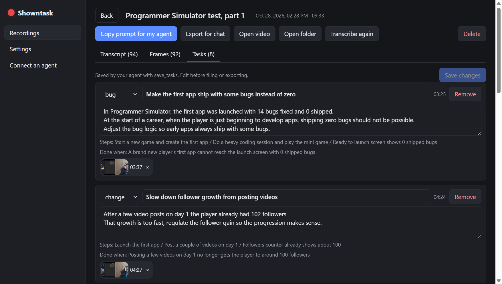
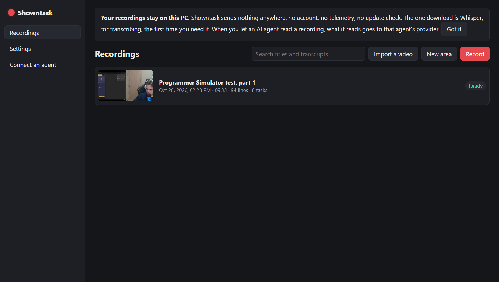

# Showntask

Record your screen and talk. Your own AI agent turns it into tasks, with screenshots.

Showntask records an area of the screen and your voice, transcribes it on your PC with Whisper,
and keeps candidate frames from the video. It is also an MCP server, so Claude Code, Codex,
Cursor, Claude Desktop or any MCP client can read the recording, look at the frames, write the
tasks and file them on your board (GitHub Issues, Linear, Jira, Trello, Asana, Azure DevOps)
through the connectors you already have.

No API keys, no account, no cloud. Showntask never calls an AI model; your agent does the work on
your own subscription.

Free and open source (MIT). Windows 10 and 11 for now.



## Quick start

1. Install from [Releases](https://github.com/ZazaGdev/Showntask/releases/latest).
2. Connect your agent once: open **Connect an agent** in the app, copy the line for Claude Code,
   Codex, Cursor, Claude Desktop or VS Code, and run or paste it (details [below](#connect-an-agent)).
3. Press **Ctrl+Alt+T**, drag over an area, talk through what you see, press **Ctrl+Alt+T** again.
4. Ask your agent: "make tasks from my last Showntask recording".

## Install

Download `Showntask-Setup-<version>.exe` from
[Releases](https://github.com/ZazaGdev/Showntask/releases/latest) and run it. The installer is not signed
yet, so Windows SmartScreen shows "Windows protected your PC": click **More info**, then
**Run anyway**.

On first use Showntask downloads whisper.cpp (about 9 MB) and a Whisper model (about 190 MB by
default) into `%APPDATA%\Showntask\speech`. If you already have whisper.cpp and a model, point
Settings at that folder instead.

## Use

1. Press **Ctrl+Alt+T** (or Record), drag over the area to record, press Record. Talk while
   you work. Press **Ctrl+Alt+K** to mark a moment that must become a task.
2. Press **Ctrl+Alt+T** again to stop. Showntask pulls out the sound, transcribes it and picks
   candidate frames in the background.
3. Ask your agent: "make tasks from my last Showntask recording", or run the `make-tasks` prompt
   (in Claude Code: `/mcp__showntask__make-tasks`). It reads the transcript, looks at contact
   sheets of the frames, picks the ones that show each point, shows you the list and saves it.
4. Then "file them on GitHub" (or run `file-tasks`): your agent creates the issues with your own
   connector and Showntask remembers what went where.

**Import a video** you already have (OBS, Loom, a phone) from the Recordings page.



## Connect an agent

The Connect page in the app shows the exact line for each agent, with a copy button. For
Claude Code:

```
claude mcp add --scope user showntask -- "C:\Users\<you>\AppData\Local\Programs\Showntask\Showntask.exe" --mcp
```

Codex (`%USERPROFILE%\.codex\config.toml`):

```toml
[mcp_servers.showntask]
command = 'C:\Users\<you>\AppData\Local\Programs\Showntask\Showntask.exe'
args = ['--mcp']
```

Cursor, Claude Desktop and VS Code take the same command and `--mcp` in their `mcp.json`.

**No MCP?** Every recording's folder (`%USERPROFILE%\Showntask\<date-time>`) holds
`transcript.md`, the frames and `MAKE-TASKS.md`. Tell any agent that can read files: "Read
`<folder>\MAKE-TASKS.md` and do what it says". For claude.ai or ChatGPT in a browser, use
**Export for chat** and upload the zip.

## MCP tools

| Tool | What it gives |
|---|---|
| `list_recordings` | Your recordings: id, title, length, line and task counts |
| `get_recording` | Metadata and the timed transcript |
| `get_transcript` | Part of a transcript, for long recordings |
| `get_frame`, `get_frames` | Frames as images, nearest the seconds asked |
| `list_candidates` | The candidate frames in a span and why each was picked |
| `get_contact_sheet` | One image of a span's candidates, labelled |
| `suggest_frames` | The best candidates ranked without looking, for agents without vision |
| `search_transcripts` | Lines matching words across recordings |
| `get_tasks`, `save_tasks`, `mark_filed` | The task list in the recording's folder |
| `get_instructions` | The prompts as text, for clients without prompts |

Prompts: `make-tasks`, `file-tasks`, `summarise-recording`. Resources:
`showntask://recordings/<id>/transcript.md`, `meta.json`, `tasks.json`, `frames/<mmss>.jpg`.

## Boards

| Field | GitHub Issues | Linear | Jira | Trello | Asana | Azure DevOps |
|---|---|---|---|---|---|---|
| title | title | title | summary | card name | task name | Title |
| description, steps, done when | body | description | description | card description | notes | Description / Repro Steps |
| kind | label | label or type | issue type | label | tag | work item type |
| frames | image in body | attachment | attachment | attachment | attachment | attachment |

Many connectors cannot upload local images; then the agent writes each frame's path into the
item and tells you which ones to drag in.

## Privacy

- Nothing leaves your PC from Showntask: no telemetry, no account, no update check. The only
  download is Whisper, once.
- Once your agent reads a recording, its transcript and the frames it looks at go to that
  agent's AI provider, under your terms with them.
- Frames can show secrets. Delete a frame, or everything said and shown in a span, from the
  recording's page before an agent sees it. Showntask's own windows are kept out of the video.
- Old recordings can be deleted automatically (Settings).
- The MCP server only reads the recordings folder and never runs commands.

## Cost

Showntask is free. Your agent's work runs on your own subscription: a long talk is a long
transcript, and each contact sheet or frame is an image (Claude bills about width x height / 750
tokens per image, so 1,200 tokens for a 1280x720 frame). The make-tasks prompt tells the agent
to look at sheets first and fetch only the frames it keeps. Turn frame viewing off in Settings
to pick frames without looking.

## Build from source

```
npm install
npm test          # unit tests
npm run smoke     # hidden end-to-end run: records a painted canvas, never your screen
npm start
npm run dist      # dist\Showntask-Setup-<version>.exe
```

Plain JavaScript, Electron, no build step. No ffmpeg: WebM, MKV and MP4 are read by Showntask's
own readers and decoded with WebCodecs.

## Licence

MIT. whisper.cpp (MIT) is downloaded at first use, not bundled.
